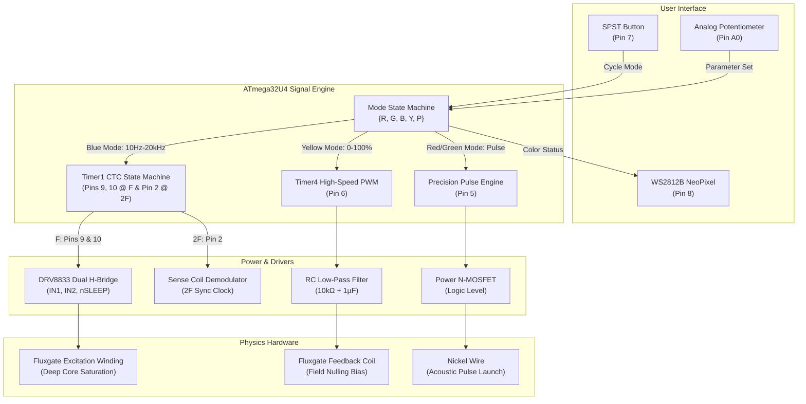
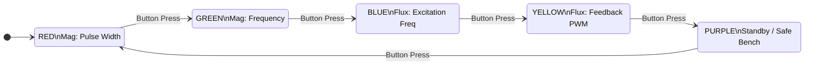

# MagNiche: Dual Niche Magnetic Signal Generator
## Comprehensive Operations Manual & Bench Guide
**Target Platform:** SparkFun Pro Micro 5V / 16MHz (Microchip ATmega32U4)  
**Firmware Version:** 1.0  
**Project:** MagNiche Signal Generator for Oscilloscope Analysis

---

## 1. Executive Summary & Architecture

The **MagNiche** instrument is a dual-purpose laboratory signal generator built on the ATmega32U4 microcontroller. It provides low-noise, crystal-accurate excitation signals for exploring two niche electromagnetic phenomena:
1. **Magnetostrictive Stress Waves in Nickel Wire**: High-current pulsed excitation via a logic-level Power MOSFET to launch longitudinal or torsional acoustic wave packets along ferromagnetic wire.
2. **Billingsley-Type Second-Harmonic Fluxgate Magnetometry**: Symmetrical push-pull AC saturation excitation via a DRV8833 dual H-bridge, combined with high-frequency PWM filtered to DC for closed-loop ambient magnetic field nulling.

The ATmega32U4 functions exclusively as an **active signal source** optimized for bench oscilloscopes. All detection, wave packet interpretation, time-of-flight calculation, and harmonic balance are performed visually by the researcher using an oscilloscope.



---

## 2. Hardware Pinout & Circuit Interconnects

### 2.1 Complete Pinout Table

| Pro Micro Pin | ATmega32U4 Port | Hardware Connection | Electrical Characteristics | Function |
|---|---|---|---|---|
| **A0** (Pin 18) | `PF7` | **Potentiometer Wiper** | 0.0V – 5.0V Analog In | Real-time parameter tuning |
| **Pin 7** | `PE6` | **SPST Button** | Active-LOW, Internal Pull-Up | Debounced mode stepper |
| **Pin 8** | `PB4` | **NeoPixel DIN** | 5V NRZ Data stream | WS2812B Single RGB LED |
| **Pin 9** | `PB5` (OC1A) | **DRV8833 IN1** | Phase A Push-Pull (0–5V) | Symmetrical AC Excitation ($F$) |
| **Pin 10** | `PB6` (OC1B) | **DRV8833 IN2** | Phase B Push-Pull (0–5V) | Symmetrical AC Excitation ($F$, 180°) |
| **Pin 2** | `PD1` | **Demod Sync 2F** | 5V Square Wave ($2F$) | Synchronous 2X reference clock for sense demodulator |
| **Pin 4** | `PD4` | **DRV8833 nSLEEP** | Active-HIGH Logic Output | Driver Enable / Sleep control |
| **Pin 6** | `PD7` | **DRV8833 IN3** | 10.0 kHz Timer3 PWM / Logic (0–5V) | Bipolar feedback nulling bridge (Channel B) |
| **Pin 3** | `PD0` | **DRV8833 IN4** | 10.0 kHz Timer3 PWM / Logic (0–5V) | Bipolar feedback nulling bridge (Channel B) |
| **Pin 5** | `PC6` | **Inverting Gate Driver** | Active-LOW, Pull-up enabled (Idle HIGH) | Precision active-LOW pulse to inverting driver |
| **VCC** | VCC | **Logic Rail** | 5.0V DC Regulated | Logic and NeoPixel power |
| **GND** | GND | **System Ground** | 0V Reference | Common Star Ground |

---

### 2.2 Driver Schematics & Circuit Interfacing

#### A. Magnetostrictive Nickel Wire Driver
Connect an inverting gate driver (e.g., TC4428, TC4427, MCP1402, or discrete inverting stage) between Pin 5 and the power N-MOSFET gate. Pin 5 operates **active-LOW** with the microcontroller's internal pull-up enabled:
```
                +12V to +24V (High Current Pulse Supply)
                      |
                      +------- [Current Limiting Resistor / Inductor]
                      |
                 [Nickel Wire] (Magnetostrictive Delay Line)
                      |
                      +------- Oscilloscope Channel 1 (Drain Pulse)
                      |
                   D |---| 
                     |   |  Power N-MOSFET (Logic Level)
                     |---|
                   S   |
                      === GND (Star Ground)
                       |
               +-------+
               |
  Pro Micro   |      +---------------------+
  Pin 5 ------+----->| IN             OUT  |-----> Gate of Power N-MOSFET
  (Active-LOW        | Inverting Driver    |
   Internal Pull-up) | GND             VCC |<---- +12V / +5V Driver Rail
                     +---------------------+
                                |
                               === GND
```
* **Quiescent / Idle State:** Pin 5 is held **HIGH** (+5V), causing the inverting driver to hold the MOSFET gate **LOW (0V / OFF)**.
* **Active Pulse:** Pin 5 drops **LOW** (0V) for the programmed duration $\tau$ ($1 - 2000\text{ }\mu\text{s}$), causing the inverting driver to pull the MOSFET gate **HIGH (VCC / ON)** to pulse the nickel wire.
* **Boot Safety:** Microcontroller initializes internal pull-up *before* asserting output mode to prevent any transient LOW glitch at boot.

#### B. DRV8833 Fluxgate Excitation & 2F Demodulator Connection
```
  Pro Micro Pin 9  ----------------> DRV8833 IN1 (Phase A @ F)
  Pro Micro Pin 10 ----------------> DRV8833 IN2 (Phase B @ F, 180 deg)
  Pro Micro Pin 4  ----------------> DRV8833 nSLEEP
  Pro Micro Pin 2  ----------------> Sense Coil Synchronous Demodulator (2F)
  5V Logic         ----------------> DRV8833 VINT / VCC
  Excitation Supply (VM: 5V - 10V) -> DRV8833 VM
  GND              ----------------> DRV8833 GND

  DRV8833 OUT1 ---------------------\
                                     [Excitation Toroid / Bobbin]
  DRV8833 OUT2 ---------------------/
```

#### C. Billingsley Bipolar Feedback DC Bias Filter (DRV8833 Channel B)
The second H-bridge of the DRV8833 (`IN3` = Pin 6, `IN4` = Pin 3) drives a bipolar DC voltage across an RC filter and nulling coil:
```
  Pro Micro Pin 6 (Timer3 10 kHz) ---> DRV8833 IN3
  Pro Micro Pin 3 (Timer3 10 kHz) ---> DRV8833 IN4

  DRV8833 OUT3 -----[ R ]-----+-----> Nulling Coil (+)
                              |
                           [ C_big ]  (Bipolar DC Filter Capacitor)
                              |
  DRV8833 OUT4 -----[ R ]-----+-----> Nulling Coil (-)
```
* **Pot at Center (ADC 487–537):** `IN3 = 0, IN4 = 0` -> **`OUT3` and `OUT4` both FLOATING (Hi-Z)**.
* **Pot CW from Center (0% to +100%):** `IN3 = HIGH, IN4 = invPWM(100% - D)` -> **`OUT4` solidly grounded**, `OUT3` PWM'd from `0%` to `100%` `VM` (slow-decay drive/brake).
* **Pot CCW from Center (0% to -100%):** `IN4 = HIGH, IN3 = invPWM(100% - D)` -> **`OUT3` solidly grounded**, `OUT4` PWM'd from `0%` to `100%` `VM` (slow-decay drive/brake).

---

## 3. Operating Modes & UI State Machine

Pressing the momentary pushbutton advances through the **5-state cyclical ring**:

```
[RED]  ──>  [GREEN]  ──>  [BLUE]  ──>  [YELLOW]  ──>  [PURPLE]  ──>  [RED]
```



---

### 3.1 Mode Detailed Specifications

#### State 1: RED — Magnetostrictive Pulse Width
* **NeoPixel:** Solid Red (`#FF0000`)
* **Hardware State:** Magnetostriction MOSFET active; DRV8833 sleeping (`nSLEEP=0`); Feedback PWM 0V.
* **Potentiometer Function:** Varies gate pulse duration $\tau$ from **$1.0\text{ }\mu\text{s}$ to $2000.0\text{ }\mu\text{s}$**.
* **Mapping Curve:** Squared power taper:
  $$\tau = \tau_{min} + (\tau_{max} - \tau_{min}) \cdot \left(\frac{\text{ADC}}{1023}\right)^2$$
  Provides microsecond precision in the $1\text{ }\mu\text{s} - 50\text{ }\mu\text{s}$ acoustic transit range while still accessing long heating/saturation pulses up to $2\text{ ms}$.
* **Safety Duty Clamp:** Hardware automatically enforces:
  $$\tau_{actual} \le \min\left(\tau_{set},\, 0.50 \cdot T_{period}\right)$$
  Preventing continuous DC short-circuit conditions.

#### State 2: GREEN — Magnetostrictive Repetition Frequency
* **NeoPixel:** Solid Green (`#00FF00`)
* **Hardware State:** Magnetostriction MOSFET active with currently stored pulse width; DRV8833 sleeping.
* **Potentiometer Function:** Varies repetition frequency $f_{rep}$ from **$1.0\text{ Hz}$ to $1000.0\text{ Hz}$**.
* **Mapping Curve:** Squared power taper:
  $$f_{rep} = f_{min} + (f_{max} - f_{min}) \cdot \left(\frac{\text{ADC}}{1023}\right)^2$$
  Enables fine tuning across low pulse repetition rates ($1 - 20\text{ Hz}$) so acoustic echoes dissipate before the subsequent pulse launches.

#### State 3: BLUE — Fluxgate DRV8833 Excitation Frequency *(Active Boot Default)*
* **NeoPixel:** Solid Blue (`#0000FF`)
* **Hardware State:** DRV8833 awake (`nSLEEP=1`); Timer1 CTC 4-step ISR state machine active on Pins 9, 10 ($F$) and Pin 2 ($2F$); Feedback PWM active at stored duty cycle. **Bench Hardware Debugging:** In addition, Pin 5 simultaneously outputs active-LOW $3.0\text{ }\mu\text{s}$ pulses at $100.0\text{ Hz}$ rate directly upon boot/reset.
* **Frequency Range:** **$10.0\text{ Hz}$ to $20.0\text{ kHz}$** (defaults to **$160.0\text{ Hz}$** excitation / **$320.0\text{ Hz}$** 2F sync on boot/reset for bench hardware debugging).
* **Control:** Currently locked to the startup / CLI frequency (`flux_f <val>`) so floating or resting potentiometer noise on `A0` cannot shift the test frequency during hardware debugging.
* **Waveform Quality:** Symmetric 50% push-pull square wave at $F$ across Pins 9 & 10 with break-before-make switching order, phase-locked to a 50% duty square wave at $2F$ on Pin 2.

#### State 4: YELLOW — Fluxgate Bipolar Feedback DC PWM
* **NeoPixel:** Solid Yellow (`#FFB400`)
* **Hardware State:** DRV8833 Channel A continuous excitation at stored frequency; DRV8833 Channel B (Pins 6 & 3) active in bipolar nulling mode; Pin 5 clamped HIGH (MOSFET OFF).
* **Potentiometer Function:** Bipolar center-off control (`-100.0%` full CCW to `0.0%` center floating deadband to `+100.0%` full CW). Also active in BLUE mode while excitation frequency is locked to CLI/default for bench debugging.
* **Resolution:** ~1550 discrete levels per polarity at **10.00 kHz** carrier frequency (independent 16-bit Timer3, completely decoupled from Timer1 toroid excitation and Timer0 `millis()`).
* **Purpose:** Drives bipolar opposing magnetic flux through the Billingsley feedback winding to null the secondary 2nd-harmonic signal to zero.

#### State 5: PURPLE — Safe Standby / Bench Rest
* **NeoPixel:** Solid Purple (`#B400FF`)
* **Hardware State:** **ALL DRIVERS IN SAFE DE-ENERGIZED STATE.**
  * Pin 5 (Inverting Gate Driver): **5.0V (Idle HIGH)** -> Inverting driver holds MOSFET Gate at **0.0V (OFF)**
  * Pins 9 & 10 (DRV8833 IN1/IN2): 0.0V
  * Pin 2 (2F Demod Sync): 0.0V
  * Pin 4 (DRV8833 nSLEEP): 0.0V (driver power stage disabled in low-power sleep)
  * Pin 6 (Feedback PWM): 0.0V
* **Purpose:** Allows hands-on probe re-positioning, wiring modifications, temperature cooling, and measuring oscilloscope quiescent noise floors without disconnecting power supplies.

---

### 3.2 Potentiometer Soft Takeover ("Pickup") Algorithm
To prevent abrasive parameter jumping when rotating between modes with a single potentiometer:
1. Upon entering a new mode, the potentiometer's entry position is captured: $\text{ADC}_{entry}$.
2. The active parameter remains locked at its saved memory setting.
3. The software requires a deliberate physical movement threshold ($\Delta \ge 50\text{ ADC counts}$, $\approx 5\%$ rotation, with a $10$-count noise deadband) before taking control of the active parameter.
4. Once unlocked, parameter tracking is smooth and real-time.

---

## 4. Oscilloscope Probing & Measurement Protocols

### 4.1 Magnetostriction & Delay-Line Pulse Echoes

```
[Pro Micro Pin 5] ---> [Inverting Gate Driver] ---> Gate of N-MOSFET (Ch 1 Trigger)
                                                         |
                                                    [Nickel Wire] <=== Current Pulse Launches Strain Wave
                                                         |
[Acoustic Sensor Coil/Piezo] ---------------------- Scope Channel 2 (Echo Detection)
```

1. **Oscilloscope Configuration:**
   * **Channel 1:** Connect $10\times$ probe to MOSFET Gate (after driver) or Pin 5 (microcontroller output). Set vertical scale to $2\text{ V/div}$.
   * **Trigger:**
     * If probing **MOSFET Gate (after driver)**: Set trigger source to **Channel 1, Rising Edge**, Normal Trigger Mode.
     * If probing **Pin 5 directly**: Set trigger source to **Channel 1, Falling Edge** (active-LOW pulse).
   * **Channel 2:** Connect to pickup coil or piezo sensor wrapped around the nickel wire. Set vertical scale to $10\text{ mV/div} - 50\text{ mV/div}$ AC coupled.
   * **Timebase:** Set to $20\text{ }\mu\text{s/div} - 50\text{ }\mu\text{s/div}$.
2. **Measurement Procedure:**
   * Enter **RED Mode**: Set pulse width to approximately $15\text{ }\mu\text{s} - 30\text{ }\mu\text{s}$.
   * Enter **GREEN Mode**: Set repetition rate to $20\text{ Hz} - 50\text{ Hz}$.
   * Observe the acoustic propagation delay $\Delta t$ on Channel 2 relative to Channel 1.
   * Calculate velocity of sound in nickel:
     $$v_{acoustic} = \frac{\text{Distance between launch and pickup (m)}}{\Delta t\text{ (s)}} \approx 4800\text{ m/s (longitudinal)}$$
   * Vary the pulse width in **RED Mode** to find the acoustic resonance peak where pulse width matches half the transducer acoustic transit time.

---

### 4.2 Fluxgate Magnetometer & Billingsley Nulling

```
[Pro Micro Pin 9 (IN1)]  ---> DRV8833 IN1 ---> [OUT1] ----\  Symmetrical Drive (F)
[Pro Micro Pin 10 (IN2)] ---> DRV8833 IN2 ---> [OUT2] ----/  [Excitation Coil]

[Pro Micro Pin 2 (2F)]   ---> [Sense Demodulator Switch]     (Lockstep 2F Reference)
[Pro Micro Pin 6]        ---> [RC Low-Pass Filter] --------> [Feedback Coil]

[Secondary Sense Winding] --------------------------------> Scope Channel 2 (or Demod Input)
[Pro Micro Pin 9 Reference] ------------------------------> Scope Channel 1 (Trigger)
```

1. **Oscilloscope Configuration:**
   * **Channel 1:** Connect to Pin 9 (DRV8833 Phase A @ $F$). Set to $2\text{ V/div}$, DC coupled.
   * **Trigger:** Set trigger source to **Channel 1, Rising Edge**.
   * **Channel 2:** Connect to secondary sense winding (or demodulated output). Set vertical scale to $20\text{ mV/div} - 100\text{ mV/div}$, AC coupled.
   * **Channel 3 (optional):** Connect to **Pin 2** ($2F$ Sync clock) to verify phase-locked synchronous demodulator timing relative to Pin 9.
   * **Timebase:** Set to $1\text{ ms/div}$ (for default $160\text{ Hz}$ excitation / $320\text{ Hz}$ demod) or $20\text{ }\mu\text{s/div}$ (for $10\text{ kHz}$ excitation).
2. **Harmonic Analysis & Field Nulling:**
   * In **BLUE Mode**, boot defaults to **$160\text{ Hz}$** ($2F = 320\text{ Hz}$), or tune via `flux_f <val>` anywhere in **$10\text{ Hz} - 20\text{ kHz}$**.
   * In zero ambient field, the secondary waveform contains only odd harmonics ($1f, 3f, 5f\dots$).
   * Bring a small permanent magnet near the sensor: the symmetry collapses and a prominent **$2f$ (second harmonic, e.g. $320\text{ Hz}$ at $160\text{ Hz}$ drive)** signal appears on Channel 2.
   * Switch to **YELLOW Mode**: Turn the potentiometer (or send `flux_fb <pct>`) to adjust the DC feedback current.
   * Observe the $2f$ envelope shrinking on Channel 2 until it reaches **total null**.
   * The potentiometer position / PWM duty cycle at null is directly proportional to the external magnetic field vector component along the sensor axis!

---

## 5. Firmware Architecture & Timer Design

### 5.1 Timer Allocation Matrix

| Timer | Peripheral Mode | Target Pins | Characteristics |
|---|---|---|---|
| **Timer0** (8-bit) | Fast PWM | Internal | Preserved for Arduino `millis()` and `micros()` timekeeping |
| **Timer1** (16-bit) | CTC (Mode 4, `WGM12`) | **Pins 9, 10 & 2** | 4-step ISR state machine at $4F$ driving `IN1`/`IN2` ($F$) and `2F Sync` ($2F$) in phase lock |
| **Timer3** (16-bit) | Unmodified | Available | Spares reserved |
| **Timer4** (10-bit HS) | High-Speed Fast PWM | **Pin 6** | Prescaler 1:1 ($\sim 62.5\text{ kHz}$) carrier for ripple-free DC feedback |

### 5.2 Timer1 State-Machine Mathematics ($10\text{ Hz} - 20\text{ kHz}$)
Timer1 runs in CTC Mode 4 (`TOP = OCR1A`) with automatic prescaler selection ($N = 8$ for $f_{exc} < 65\text{ Hz}$, $N = 1$ for $f_{exc} \ge 65\text{ Hz}$) and `TIMER1_COMPA_vect` firing at **$4 \times F$**:
$$f_{int} = 4 \cdot f_{exc} = \frac{F_{CPU}}{N \cdot (OCR1A + 1)}$$
$$OCR1A = \text{round}\left(\frac{16,000,000}{N \cdot 4 \cdot f_{exc}}\right) - 1$$
* At $10\text{ Hz}$ ($2F = 20\text{ Hz}$, $N=8$): $f_{int} = 40\text{ Hz} \implies OCR1A = 49999$
* At $160\text{ Hz}$ ($2F = 320\text{ Hz}$, $N=1$): $f_{int} = 640\text{ Hz} \implies OCR1A = 24999$
* At $20.0\text{ kHz}$ ($2F = 40.0\text{ kHz}$, $N=1$): $f_{int} = 80\text{ kHz} \implies OCR1A = 199$

Each cycle advances through 4 quadrant states:
* **Step 0 ($0^\circ$):** `IN2 = LOW` then `IN1 = HIGH`, `2F = HIGH`
* **Step 1 ($90^\circ$):** `2F = LOW`
* **Step 2 ($180^\circ$):** `IN1 = LOW` then `IN2 = HIGH`, `2F = HIGH`
* **Step 3 ($270^\circ$):** `2F = LOW`

Because `IN2` / `IN1` are cleared before the complementary leg is raised (break-before-make) and direct port registers (`PORTB`, `PORTD`) toggle in single instructions, both $F$ and $2F$ remain in tight phase lock.

---

## 6. Serial Telemetry & Interactive Development CLI

The ATmega32U4 provides a non-blocking interactive serial command line interface (CLI) and real-time telemetry over native USB CDC at **115200 baud**.

### 6.1 Available Serial Commands

| Command | Arguments | Example | Description |
|---|---|---|---|
| `flux` | *none* | `flux` | Sets up and activates FluxGate driving mode (`nSLEEP=HIGH`, Timer1 active, LED: BLUE). |
| `flux_f` | `<frequency>` | `flux_f 160`<br>`flux_f 12.5k` | Sets DRV8833 excitation frequency (**10 Hz to 20000 Hz**; 2F pin tracks at $2\times$). Omitting argument prints current frequency. |
| `flux_fb` | `<duty_pct>` | `flux_fb 35.5` | Sets feedback DC PWM duty cycle (0.0% to 100.0%). |
| `mag` | *none* | `mag` | Sets up and activates Magnetostrictive mode (MOSFET Gate active, LED: RED). |
| `mag_pw` | `<microseconds>` | `mag_pw 45.0` | Sets pulse width in $\mu\text{s}$ (1.0 to 2000.0 $\mu\text{s}$). |
| `mag_f` | `<frequency>` | `mag_f 50` | Sets pulse repetition frequency (1.0 to 1000.0 Hz). |
| `standby` / `stop` | *none* | `standby` | Forces all generator outputs LOW and sleeps DRV8833 (LED: PURPLE). |
| `status` | *none* | `status` | Displays full system parameters and hardware state. |
| `help` / `?` | *none* | `help` | Prints the serial CLI command reference. |

* **Flexible Syntax:** Arguments can be separated by spaces, `=`, or `:` (e.g. `flux_f 10000`, `flux_f=10k`, or `flux_f: 12500`).
* **Unit Recognition:** Frequencies accept numeric values or `k` / `K` suffixes (e.g. `8k` = 8000 Hz, `12.5k` = 12500 Hz).

### 6.2 Example Terminal Session

```text
MagNiche> flux
[OK] FluxGate driving mode ACTIVE (DRV8833 Pins D9/D10, nSLEEP Pin D4=HIGH)
     Excitation Freq: 160.0 Hz | Feedback PWM: 0.0 %
MagNiche> flux_f 12.5k
[OK] FluxGate excitation frequency set to: 12500.00 Hz (Period: 80.00 us)
     Synchronous 2F Demod (Pin D2): 25000.00 Hz (Period: 40.00 us)
MagNiche> status

------------------------------------------------------------
[MODE: BLUE] FluxGate - Adjusting EXCITATION FREQ (10 Hz - 20 kHz)
  >> Magnetostriction (MOSFET Gate Pin D5): OFF
  >> FluxGate Excitation (DRV8833 Pins D9/D10): ACTIVE @ 12.500 kHz
  >> Sense Demod Sync 2F (Pin D2)             : ACTIVE @ 25.000 kHz
     Feedback DC PWM (Pin D6)              : 0.00 %
------------------------------------------------------------
MagNiche> 
```


